# 🏢 VoiceAI Studio — Complete Admin & User Panel Workflows

---

# 🔐 WHO LOGS IN — OVERVIEW

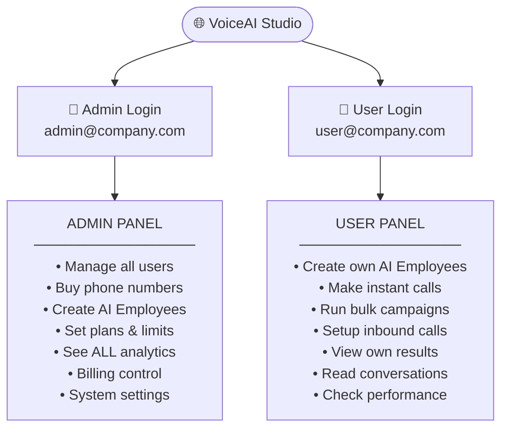

---

# ═══════════════════════════════
# 👑 ADMIN PANEL — COMPLETE FLOW
# ═══════════════════════════════

## 🗺️ Admin Master Navigation

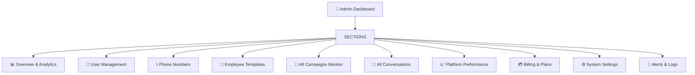

---

## 👑 A1 — ADMIN LOGIN

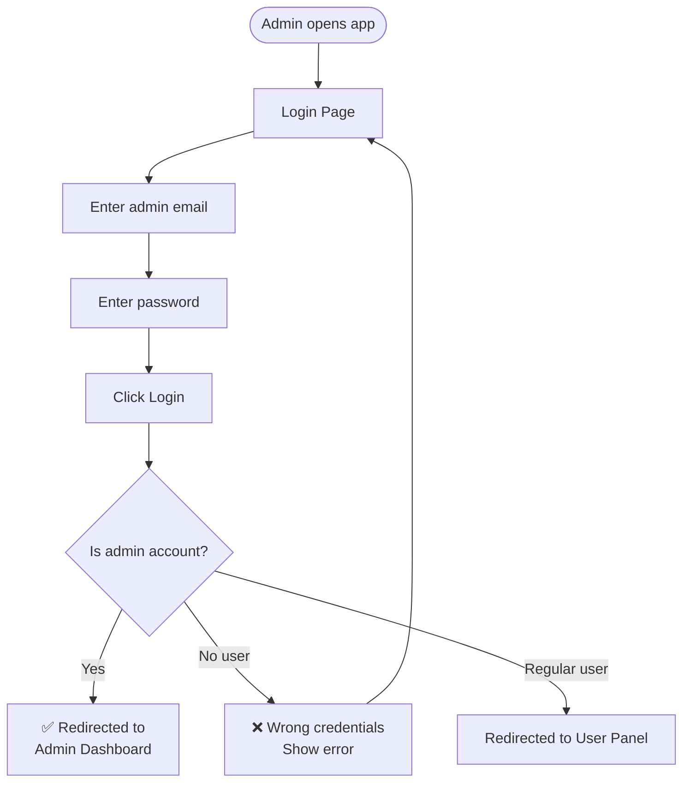

---

## 👑 A2 — ADMIN OVERVIEW (Dashboard)

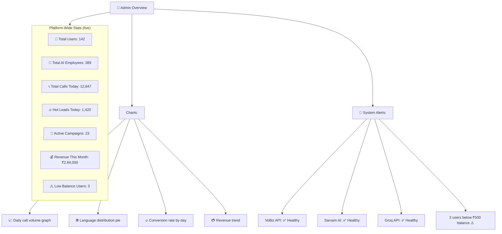

---

## 👑 A3 — USER MANAGEMENT

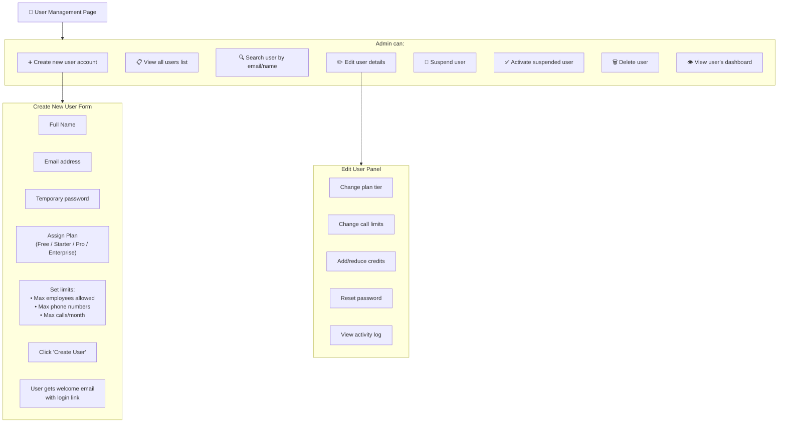

---

## 👑 A4 — PHONE NUMBERS (Admin Manages the Pool)

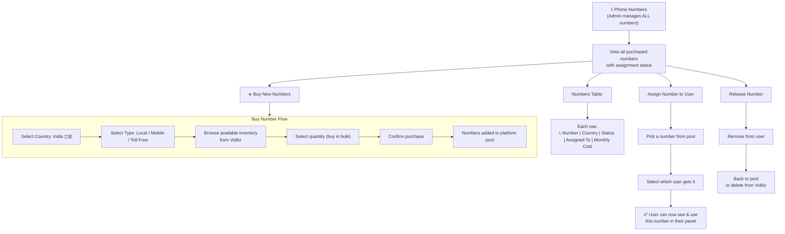

---

## 👑 A5 — EMPLOYEE TEMPLATES (Admin Creates Ready Templates)

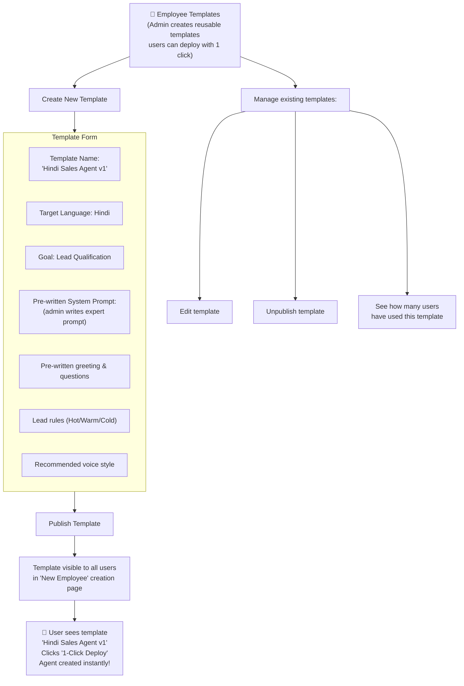

---

## 👑 A6 — ALL CAMPAIGNS MONITOR

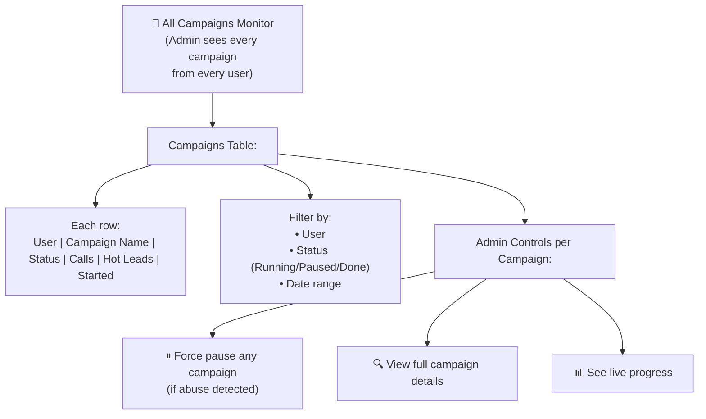

---

## 👑 A7 — BILLING & PLANS

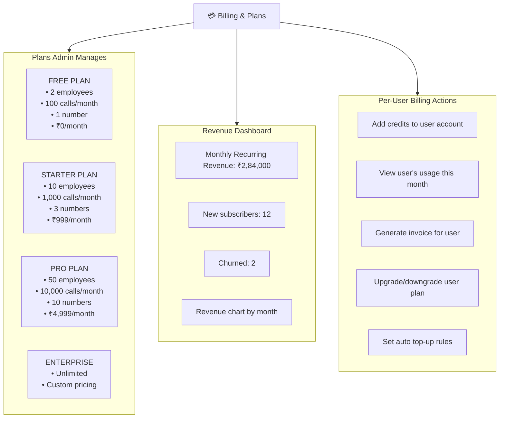

---

## 👑 A8 — SYSTEM SETTINGS

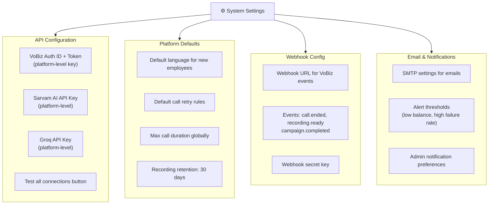

---

## 👑 A9 — ALERTS & AUDIT LOGS

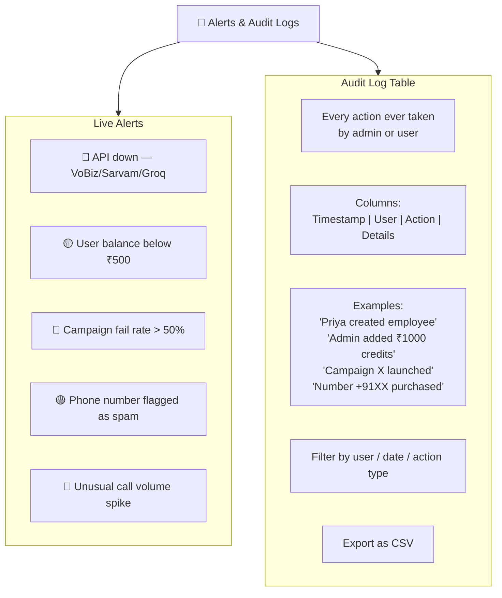

---

---

# ═══════════════════════════════
# 👤 USER PANEL — COMPLETE FLOW
# ═══════════════════════════════

## 🗺️ User Master Navigation

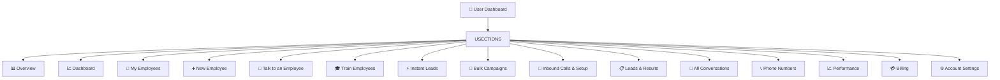

---

## 👤 U1 — USER LOGIN

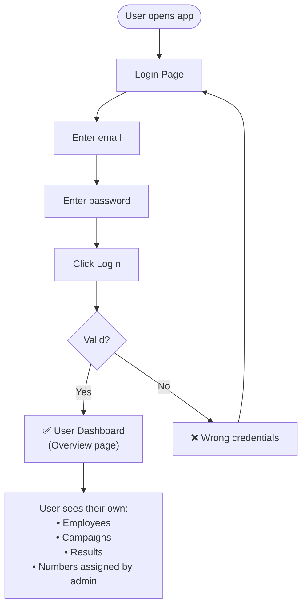

---

## 👤 U2 — OVERVIEW + DASHBOARD

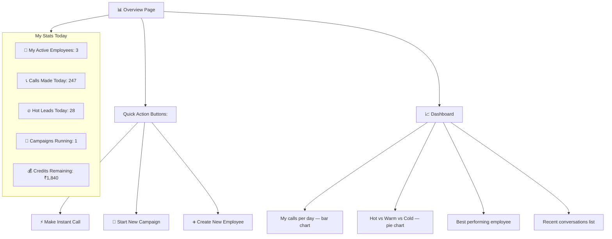

---

## 👤 U3 — MY EMPLOYEES (View & Manage)

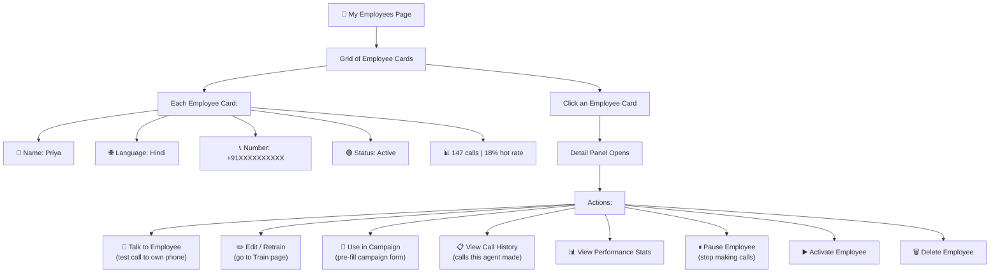

---

## 👤 U4 — NEW EMPLOYEE (Create an AI Agent)

```mermaid
flowchart TD
    NEW2(["User clicks 'New Employee'"]) --> CHOICE["Choose how to create:"]

    CHOICE --> TEMPLATE_WAY["📋 Use a Template\n(admin pre-built templates)"]
    CHOICE --> SCRATCH_WAY["✍️ Create from Scratch"]

    TEMPLATE_WAY --> PICK_TEMP["See available templates:\n• Hindi Sales Agent\n• Tamil Support Agent\n• English Lead Qualifier\n• Telugu Survey Agent"]
    PICK_TEMP --> SELECT_TEMP["Select a template"]
    SELECT_TEMP --> CUSTOMIZE["Edit the template\n(optional — can use as-is)"]
    CUSTOMIZE --> PICK_NUM["Pick Phone Number\nfrom assigned pool"]
    PICK_NUM --> DEPLOY_TEMP["Deploy ✅"]

    SCRATCH_WAY --> STEP_A

    subgraph STEP_A["Step 1 — Name & Language"]
        SA1["Employee Name: 'Priya'"]
        SA2["Select Language:\nHindi / Tamil / Telugu /\nBengali / Marathi / Gujarati /\nKannada / Malayalam / English"]
    end

    STEP_A --> STEP_B

    subgraph STEP_B["Step 2 — Goal & Script"]
        SB1["Select Goal:\n💰 Sales / 🎧 Support /\n🎯 Lead Qualify / 📅 Booking / 📋 Survey"]
        SB2["Opening Greeting:\n'Namaste! Main Priya hoon...'"]
        SB3["Screening Questions:\nQ1: Are you interested?\nQ2: What is your budget?\nQ3: When can we schedule?"]
        SB4["Closing Message:\n'Thank you! We will call back.'"]
    end

    STEP_B --> STEP_C

    subgraph STEP_C["Step 3 — Lead Rules"]
        SC1["🔥 HOT if customer says:\n'yes', 'interested', 'tell me more'"]
        SC2["🟡 WARM if customer:\nasks questions but hesitates"]
        SC3["❄️ COLD if customer says:\n'no', 'not now', 'not interested'"]
    end

    STEP_C --> STEP_D

    subgraph STEP_D["Step 4 — Pick Phone Number"]
        SD1["Admin has assigned numbers\nUser picks one:\n📞 +91 98765 XXXXX\n📞 +91 80012 XXXXX"]
    end

    STEP_D --> STEP_E

    subgraph STEP_E["Step 5 — Test Call"]
        SE1["Enter own phone number"]
        SE2["Click 'Test Now'"]
        SE3["Phone rings — talk to agent"]
        SE4["See transcript after call"]
        SE5["Happy? → Deploy\nNot happy? → Go back & edit"]
    end

    STEP_E --> DEPLOY2["🚀 Click 'Create Employee'"]
    DEPLOY2 --> CREATED["✅ Employee Created!\nNow visible in My Employees"]

    DEPLOY_TEMP --> CREATED
```

---

## 👤 U5 — TALK TO EMPLOYEE (Live Test)

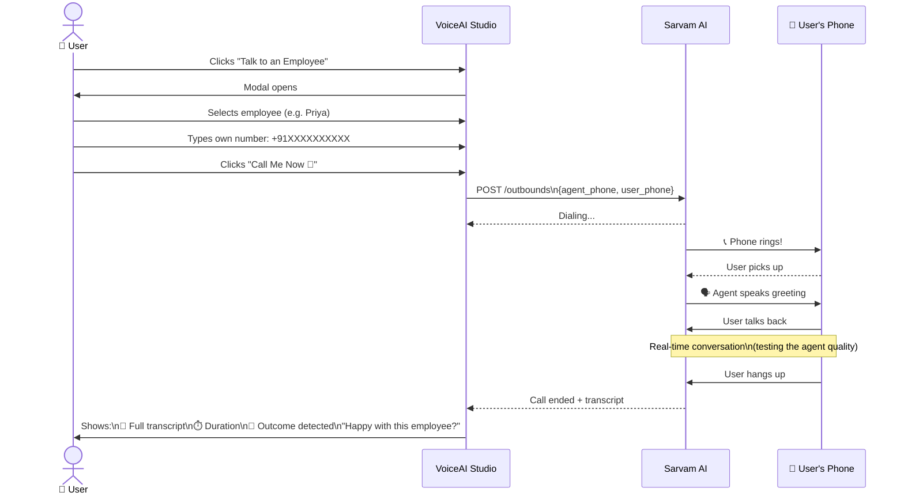

---

## 👤 U6 — TRAIN EMPLOYEES (Update Agent)

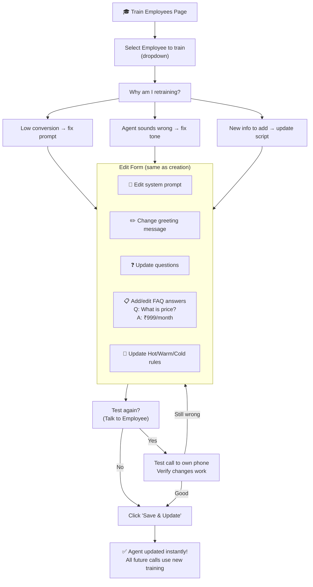

---

## 👤 U7 — INSTANT LEADS (Single Call Now)

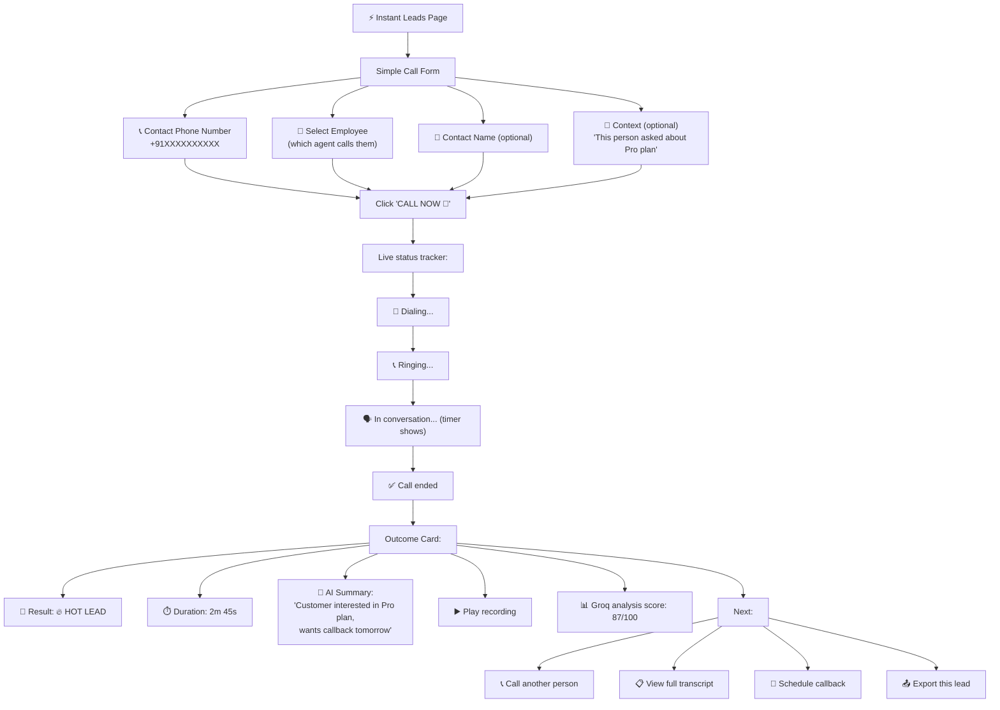

---

## 👤 U8 — BULK CAMPAIGNS (Call Hundreds at Once)

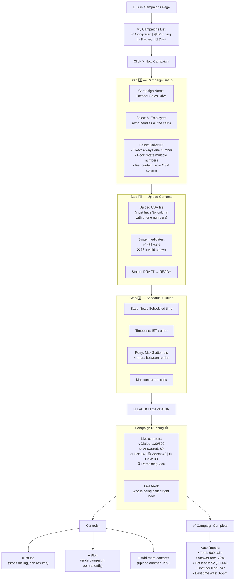

---

## 👤 U9 — INBOUND CALLS & SETUP

```mermaid
flowchart TD
    IB2["📲 Inbound Calls & Setup"] --> SEE2["User sees numbers\nassigned by admin"]

    SEE2 --> NUM_CARDS["Number Cards:"]
    NUM_CARDS --> NC1["📞 +91 98765 XXXXX\nStatus: 🔴 OFF\nAssigned to: (none)"]
    NUM_CARDS --> NC2["📞 +91 80012 XXXXX\nStatus: 🟢 ON\nEmployee: Priya"]

    NC1 --> SETUP_IB["Setup Inbound for this number"]
    SETUP_IB --> IB_FORM

    subgraph IB_FORM["Inbound Configuration"]
        IBF1["Select AI Employee\nwho picks up calls"]
        IBF2["Working Hours:\n9am–6pm / 24x7 / Custom"]
        IBF3["After-hours:\nVoicemail / Transfer / Disconnect"]
        IBF4["Language:\nAuto-detect / Fixed language"]
        IBF5["Welcome message:\n'Thank you for calling...'"]
    end

    IB_FORM --> ENABLE2["Click 'Enable Inbound ✅'"]
    ENABLE2 --> LIVE_IB["🟢 Number is LIVE\nAI Employee answers all incoming calls"]

    LIVE_IB --> INCOMING2["Customer dials +91 98765 XXXXX"]
    INCOMING2 --> PICKUP2["AI Employee picks up instantly\nspeaks in configured language"]
    PICKUP2 --> HANDLE2["Handles full conversation\n(support / booking / qualify)"]
    HANDLE2 --> LOGGED2["Auto-logged in\n'All Conversations'"]

    NC2 --> TOGGLE2["User can Toggle OFF\nif needed"]
```

---

## 👤 U10 — LEADS & RESULTS

```mermaid
flowchart TD
    LR2["📋 Leads & Results"] --> FILTER4["Filter Bar"]

    FILTER4 --> FB_A["By Campaign:\n'October Sales Drive'"]
    FILTER4 --> FB_B["By Date:\nToday / This Week / Custom"]
    FILTER4 --> FB_C["By Outcome:\n🔥 Hot / 🟡 Warm / ❄️ Cold / 📵 No Answer"]
    FILTER4 --> FB_D["By Employee:\nPriya / Ravi / Ananya"]

    FILTER4 --> TABLE4["Results Table"]

    TABLE4 --> R_ROW["Each Row:"]
    R_ROW --> RR1["📞 +91 98765 XXXXX"]
    R_ROW --> RR2["👤 John / (Unknown)"]
    R_ROW --> RR3["🎯 🔥 HOT LEAD"]
    R_ROW --> RR4["⏱️ 2m 45s"]
    R_ROW --> RR5["🤖 Priya (Hindi)"]
    R_ROW --> RR6["📝 'Interested in Pro plan'"]
    R_ROW --> RR7["▶️ Play recording"]

    R_ROW --> ROW_CLICK["Click row → Detail opens"]
    ROW_CLICK --> RD1["▶️ Full recording player"]
    ROW_CLICK --> RD2["📝 Complete transcript"]
    ROW_CLICK --> RD3["📊 Groq analysis:\nSentiment / Intent / Topics"]
    ROW_CLICK --> RD4["✏️ Add manual note"]
    ROW_CLICK --> RD5["🏷️ Change outcome tag"]
    ROW_CLICK --> RD6["📅 Schedule callback"]

    TABLE4 --> EXPORT3["📥 Export CSV\n(all filtered results)"]
```

---

## 👤 U11 — ALL CONVERSATIONS

```mermaid
flowchart TD
    AC3["💬 All Conversations"] --> CONV_LIST2["List: every call ever made\nNewest first"]

    CONV_LIST2 --> SEARCH3["🔍 Search by:\nPhone number / keyword in transcript"]

    CONV_LIST2 --> CONV_CLICK2["Click any conversation"]

    CONV_CLICK2 --> CONV_VIEW

    subgraph CONV_VIEW["Conversation View"]
        CV1["📋 Metadata:\nEmployee | Date | Duration | Language | Outcome"]
        CV2["▶️ Recording Player:\n[▶ ━━━━━━━━━━━━━] 2:45\n⬇️ Download MP3"]
        CV3["📝 Transcript:\n(color coded)\nPriya 🔵: 'Namaste...'\nCustomer ⚪: 'Haan bolo'\nPriya 🔵: 'Kya aap...'\nCustomer ⚪: 'Interested hoon'"]
        CV4["📊 Groq AI Analysis:\n😊 Sentiment: Positive (78%)\n🎯 Intent: Purchase (87%)\n⚠️ Objections: Price concern\n✅ Actions: Send brochure, callback\n🔮 Conversion: 72% likely"]
    end

    CONV_VIEW --> NOTE2["✏️ User adds note\n'Called back — meeting set'"]
    CONV_VIEW --> TAG["🏷️ Change tag:\nHot / Warm / Cold / Converted / Lost"]
```

---

## 👤 U12 — PHONE NUMBERS (User View)

```mermaid
flowchart TD
    PN3["📞 Phone Numbers\n(User sees numbers assigned by admin)"] --> MY_NUMS["My Assigned Numbers:"]

    MY_NUMS --> N_CARD["Each Number Card:"]
    N_CARD --> NC_A["📞 +91 98765 XXXXX"]
    N_CARD --> NC_B["Status: 🟢 Active"]
    N_CARD --> NC_C["Used by: Priya (employee)"]
    N_CARD --> NC_D["Inbound: ON / OFF toggle"]
    N_CARD --> NC_E["Calls today: 47"]
    N_CARD --> NC_F["Answer rate: 71%"]

    MY_NUMS --> ACTIONS6["Actions per number:"]
    ACTIONS6 --> ACT_1["Assign to a different employee"]
    ACTIONS6 --> ACT_2["Toggle inbound ON/OFF"]
    ACTIONS6 --> ACT_3["View call history for this number"]
```

---

## 👤 U13 — PERFORMANCE

```mermaid
flowchart TD
    PERF2["📈 Performance"] --> DATE2["Date filter:\nToday / Week / Month / Custom"]

    DATE2 --> CARDS2

    subgraph CARDS2["My Stats"]
        PC1["📞 Total Calls: 1,247"]
        PC2["✅ Answer Rate: 68%"]
        PC3["⏱️ Avg Duration: 2m 18s"]
        PC4["🔥 Hot Leads: 124 (10%)"]
        PC5["💰 Cost per Hot Lead: ₹45"]
    end

    DATE2 --> BY_EMP2

    subgraph BY_EMP2["By AI Employee"]
        BE_A["Priya (Hindi): 489 calls | 15% hot"]
        BE_B["Ravi (Tamil): 312 calls | 12% hot"]
        BE_C["Ananya (Telugu): 198 calls | 19% hot ⭐"]
    end

    DATE2 --> BY_CAMP2

    subgraph BY_CAMP2["By Campaign"]
        BCA["October Drive:\n500 contacts | 73% answered\n10.4% hot | ₹2,450 spent"]
    end

    DATE2 --> HEATMAP["🕐 Best Time to Call:\nHeatmap — day vs hour\nBest: Tue-Thu 3-5pm ✅\nWorst: Mon 9-10am ❌"]
```

---

## 👤 U14 — BILLING

```mermaid
flowchart TD
    BILL3["💳 Billing"] --> BAL2["💰 My Balance: ₹1,840"]
    BAL2 --> LOW2{Below ₹500?}
    LOW2 -->|Yes| LOW_WARN["⚠️ Low balance warning\nTop up now!"]
    LOW2 -->|No| FINE2["Balance healthy ✅"]

    BILL3 --> USAGE2["📊 This Month:"]
    USAGE2 --> U_A["Minutes used: 2,890 min"]
    USAGE2 --> U_B["Calls made: 1,247"]
    USAGE2 --> U_C["Numbers active: 2"]
    USAGE2 --> U_D["Estimated bill: ₹2,140"]

    BILL3 --> TOPUP2["➕ Add Credits"]
    TOPUP2 --> AMT["₹500 / ₹1000 / ₹5000 / Custom"]
    AMT --> PAY["Payment gateway\n(Razorpay)"]
    PAY --> DONE4["✅ Credits added\nInvoice emailed"]

    BILL3 --> HISTORY2["📄 Transaction History:\nDate | Amount | Reason | Balance"]
    BILL3 --> INVOICE2["🧾 Download Invoice PDF"]
```

---

## 👤 U15 — ACCOUNT SETTINGS

```mermaid
flowchart TD
    SETTINGS2["⚙️ Account Settings"] --> TABS2

    TABS2 --> T_A & T_B & T_C

    subgraph T_A["Profile Tab"]
        TA1["My Name"]
        TA2["Email"]
        TA3["Phone number"]
        TA4["Company name"]
        TA5["Change password"]
        TA6["Upload profile photo"]
    end

    subgraph T_B["Notifications Tab"]
        TB1["Email me when:\n✅ Campaign completes\n✅ Hot lead detected\n✅ Balance below ₹500"]
        TB2["WhatsApp alerts:\n(for hot leads only)"]
        TB3["Alert threshold settings"]
    end

    subgraph T_C["My Plan Tab"]
        TC1["Current plan: PRO"]
        TC2["Employees used: 3 / 50"]
        TC3["Calls this month: 1,247 / 10,000"]
        TC4["Numbers: 2 / 10"]
        TC5["Upgrade plan button"]
    end
```

---

# 🔄 ADMIN vs USER — SIDE BY SIDE COMPLETE COMPARISON

```mermaid
graph TB
    subgraph ADMIN2["👑 ADMIN CONTROLS"]
        AD_1["✅ Create & manage ALL users"]
        AD_2["✅ Buy phone numbers (bulk)"]
        AD_3["✅ Assign numbers to users"]
        AD_4["✅ Create employee templates"]
        AD_5["✅ Monitor ALL campaigns"]
        AD_6["✅ See ALL conversations"]
        AD_7["✅ Manage billing & plans"]
        AD_8["✅ Set API keys (platform-level)"]
        AD_9["✅ View platform analytics"]
        AD_10["✅ Alerts & audit logs"]
        AD_11["✅ Suspend / delete users"]
        AD_12["✅ Add credits to any user"]
    end

    subgraph USER2["👤 USER CONTROLS"]
        US_1["✅ Login & view own dashboard"]
        US_2["✅ Create own AI employees"]
        US_3["✅ Train / update own employees"]
        US_4["✅ Talk to employee (live test)"]
        US_5["✅ Make instant single calls"]
        US_6["✅ Create & run bulk campaigns"]
        US_7["✅ Setup inbound call handling"]
        US_8["✅ View own leads & results"]
        US_9["✅ Read own conversations"]
        US_10["✅ Check own performance"]
        US_11["✅ Manage own billing"]
        US_12["✅ Update own profile"]
    end
```

---

# 🔄 THE COMPLETE END-TO-END FLOW

```mermaid
sequenceDiagram
    actor A as 👑 Admin
    actor U as 👤 User
    participant APP as VoiceAI Studio
    participant VB as VoBiz
    participant SA as Sarvam AI
    participant GQ as Groq

    Note over A,APP: Admin sets up the platform
    A->>APP: Creates user account
    A->>APP: Buys phone numbers from VoBiz pool
    A->>VB: POST /AvailableNumber/ (purchases)
    A->>APP: Assigns numbers to user
    A->>APP: Sets Pro plan (50 employees, 10k calls)

    Note over U,APP: User logs in and works
    U->>APP: Login ✅
    U->>APP: Creates "Priya" AI Employee
    APP->>SA: POST /deployments (create agent)
    SA-->>APP: deployment_id + connection_id
    U->>APP: Tests Priya (Talk to Employee)
    APP->>SA: POST /outbounds (test call)
    SA->>U: 📞 Calls user's phone
    U->>APP: Priya sounds good! Save.

    Note over U,APP: User runs a campaign
    U->>APP: Creates Bulk Campaign
    U->>APP: Uploads 500 contacts CSV
    U->>APP: Launches campaign
    APP->>VB: POST /campaign/start
    VB->>SA: Each answered call routed to Priya
    SA->>SA: Priya handles conversations
    VB->>APP: Webhooks: recording.ready

    Note over U,GQ: User reviews results
    U->>APP: Opens All Conversations
    APP->>GQ: Sends recording to Whisper
    GQ-->>APP: Full transcript
    APP->>GQ: LLaMA analyzes transcript
    GQ-->>APP: Sentiment, intent, score
    APP->>U: Shows complete call intelligence

    Note over A,APP: Admin monitors everything
    A->>APP: Checks platform dashboard
    A->>APP: Sees user's 500 calls completed
    A->>APP: Reviews revenue this month
```
